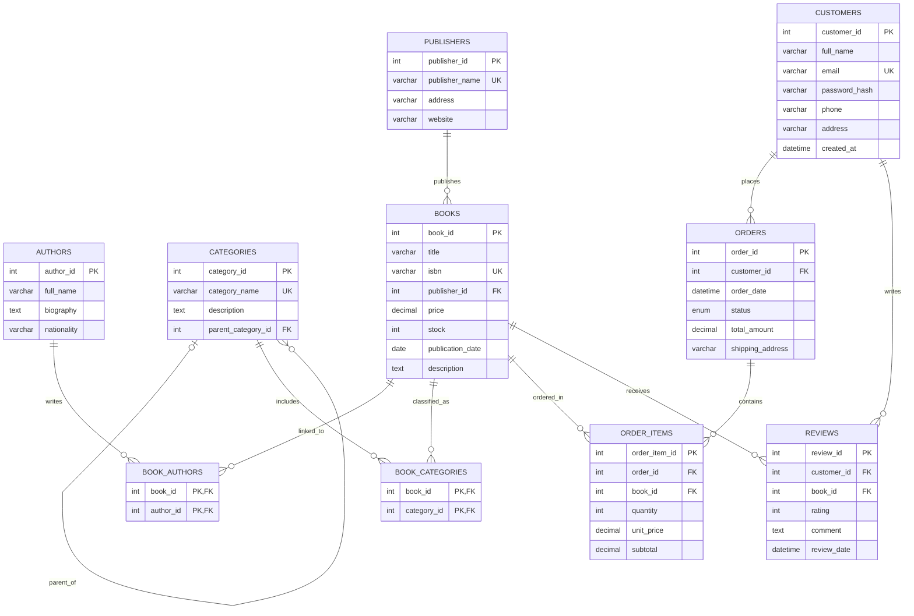

# INS3064 — Homework 06: Online Bookstore ERD

## 1. Text ERD (Mermaid)

## 2. Relationships and cardinality

| Parent | Child | Cardinality | Foreign key |
|---|---|---|---|
| publishers | books | 1:N | books.publisher_id |
| categories | categories | 1:N (optional parent) | categories.parent_category_id |
| books | book_authors | 1:N | book_authors.book_id |
| authors | book_authors | 1:N | book_authors.author_id |
| books | book_categories | 1:N | book_categories.book_id |
| categories | book_categories | 1:N | book_categories.category_id |
| customers | orders | 1:N | orders.customer_id |
| orders | order_items | 1:N | order_items.order_id |
| books | order_items | 1:N | order_items.book_id |
| customers | reviews | 1:N | reviews.customer_id |
| books | reviews | 1:N | reviews.book_id |

Books–authors and books–categories are M:N conceptually, each resolved into two 1:N relationships by a junction table. Orders–books is likewise represented through order_items.

## 3. Normalization explanation (1NF → 3NF)

- **1NF:** Attributes contain atomic values, with no author or category lists stored in `books`.
- **2NF:** Composite junction keys `(book_id,author_id)` and `(book_id,category_id)` contain no partially dependent non-key attributes. Other tables have a single primary key.
- **3NF:** Publisher details depend on `publisher_id` in `publishers`, not via `publisher_id` inside `books`; customer details live in `customers`, not `orders`. Thus non-key descriptive columns do not depend transitively on other non-key columns in the same table.
- **Financial data design note:** `order_items.unit_price` is the historical purchase price, separate from the mutable catalog price. `subtotal` is generated from quantity and unit price. `orders.total_amount` is a purposely persisted aggregate for a real order; strict nonredundancy would calculate it from order items or maintain it transactionally. In a production database a transaction or trigger must keep this snapshot synchronized.

## 4. Constraints

- `PRIMARY KEY` on all entities; composite primary keys in two junction tables.
- `FOREIGN KEY` plus suitable `CASCADE`, `RESTRICT`, `SET NULL` actions.
- `UNIQUE` on ISBN, customer email, category/publisher names, book pairs in order items, and one review per customer/book.
- `CHECK`: positive book price, positive order quantity and unit price, rating 1–5, nonnegative total and stock.
- `DEFAULT`: zero stock, pending status and timestamps.
- All tables use InnoDB and utf8mb4.
